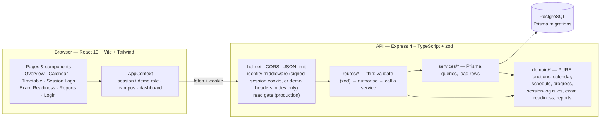
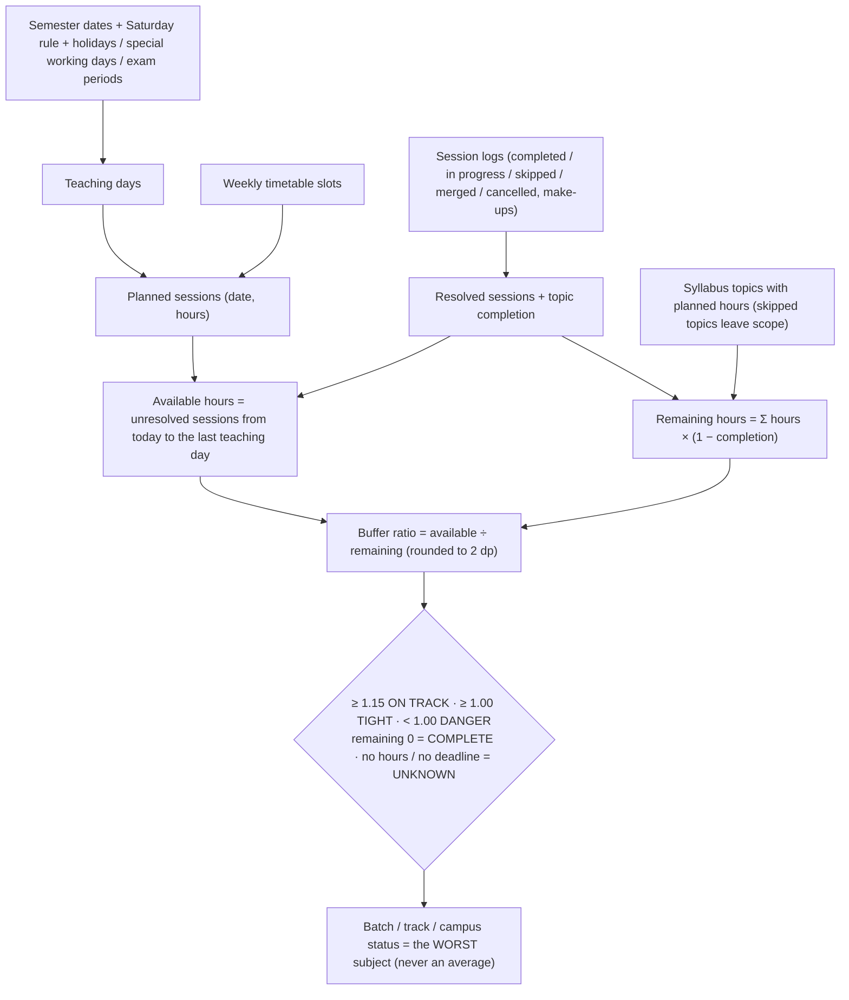

# Prospectus — architecture

## Shape of the system

* **Layering rule:** HTTP and the database never contain business rules. `api/src/domain/` has no I/O and is unit-tested with hand-calculated fixtures; `services/` loads rows and feeds the domain; `routes/` validates, authorises and serialises.
* **Nothing derived is stored.** Coverage, buffer ratio, risk, readiness, planned sessions and teaching capacity are recomputed from the timetable, calendar, exams, syllabus and session logs on every request.

## How a subject's status is computed

Deadline = the start of the preferred exam (End-term by default; per-exam for Exam Readiness), classes stop the day before. Exam Readiness runs the same engine against each exam's own start date and, when topics carry an exam tag, only the topics that exam assesses (`examScope` = first exam that assesses the topic, counted cumulatively).

## Smart carry-forward
`domain/carryForward.ts` (pure): the source is the latest Completed / In-progress / Merged log of the same subject dated before the class being logged (cancelled and skipped logs are passed over). Offered items are its COVERED-below-100 % and LEFTOVER topic entries whose *current* resolved state (latest entry wins, same as the progression engine) is still unfinished and not skipped. The UI saves the selection as ordinary `leftover` entries through the existing log API; the unique `(log, topic)` key and the `(timetable slot, date)` key make retries and corrections idempotent.

## Data model (Prisma, `api/prisma/schema.prisma`)
`Campus` · `Semester` (campus, track, dates, Saturday rule, active flag) · `Batch` · `Faculty` · `Subject` (batch, faculty) · `TimetableEntry` · `SyllabusUnit` → `SyllabusTopic` (planned hours, exam tag) · `CalendarEntry` · `Exam` (semester, optional batch) · `SessionLog` (+ `SessionTopicEntry`, `SessionLogRevision` audit trail). Deletes are restrictive; a timetable slot with logs cannot be deleted. Sample rows carry `isSample` so `npm run db:clear-sample` removes only them.

## Access control
1. **Development:** the "Preview as" picker sends `X-Demo-Role` / `X-Demo-Faculty` / `X-Demo-Batch` / `X-Demo-Campus` (spoofable; a preview sees exactly one campus — the named one or `DEMO_DEFAULT_CAMPUS` — never all by omission; a faculty/student preview that has not chosen who it is sees nothing; a real session always overrides these headers; on only when `ALLOW_DEMO_HEADERS` is true, default true in development, false in production).
2. **Evaluation / staging:** operator-issued accounts (`AUTH_USERS`, scrypt hashes) → `POST /api/auth/login` → HMAC-signed HttpOnly session cookie; logout revokes the token; sessions expire.
3. **Production gate:** with demo headers off, every `/api` route except `/health` (status only) and `/auth/*` requires a session (`/meta` needs one too and lists only the caller's campuses); writes additionally need the role's capability (`domain/permissions.ts`); faculty can only log or correct their own subjects.
4. **Student portal:** `/api/student/portal` serves one batch only — the batch comes from the account (`batchId`) on the server, never from the request; staff must name a batch; the route is read-only.
5. **Campus isolation:** `http/scope.ts` resolves a Scope per request from trusted data (admin = all unless limited by `campusIds`; manager = `campusIds`; faculty = linked faculty record's campus; student = linked batch's campus; empty = 403 `no_campus_assigned`) and every data route applies it with three helpers — `campusWhere` (restrict the Prisma query), `assertCampus` (named/target campus, 403) and `hideOutOfScope` (record by id, 404). The identity middleware attaches the scope; a test enumerates the Express router and fails if a route is not classified.
Not provided: SSO/OAuth, MFA, password reset, batch-level isolation outside the student portal, scheduled notifications. See `SUBMISSION.md`.

## Tests
`api/src/**/*.test.ts` (pure domain, security, auth, env), `api/src/**/*.int.test.ts` (real PostgreSQL via `TEST_DATABASE_URL`), `web/src/test/*.test.tsx` (components, pages, login, theme contrast, provenance), `e2e/*.spec.ts` (Playwright on :5183/:4010 with its own database).

## Within-campus authorization (audience layer)
Beyond campus scope, `api/src/http/scope.ts` derives an *audience* from the session (never from client headers): **faculty** see only subjects whose `facultyId` is theirs (and the batches, semesters, exams, timetable rows, logs, progression, readiness, calendar-linked schedule, dashboard totals, report aggregates and CSV exports that follow from them); **students** see only their linked batch and never write; campus managers see their whole campus; admins see all campuses unless limited by `campusIds`. Every route applies the filter in the Prisma query (so counts and totals are filtered too), and an out-of-audience id answers 404, exactly like a missing record. A faculty/student account whose link cannot be resolved matches nothing. Covered by `api/src/audience.int.test.ts` and `campus.int.test.ts`.
